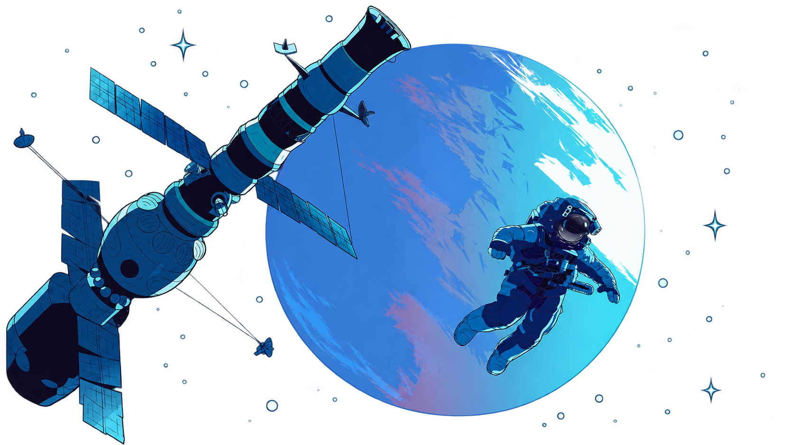
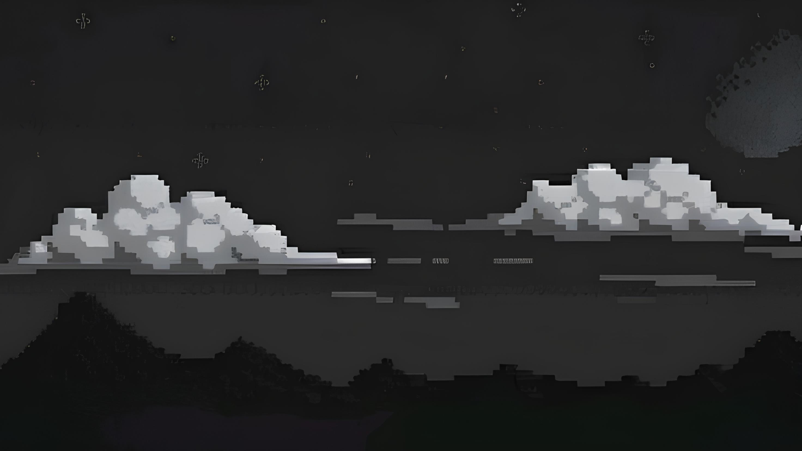

<!-- ==================== HEADER ==================== -->

  

<h3 align="center">Programming Student | Web Development</h3>

  > Turning ideas into code. 
  > Learning through every challenge. 
  > Building something better, one line at a time.

  Curious mind. Creative thinking. Endless possibilities.

---

<!-- ==================== ABOUT ME ==================== -->

<h2 align="center">⭐ About Me</h2>

  Hi! I'm Miguel Nunes, also known as Infinity, a programming
  student passionate about technology, web development, video editing
  and creating things from scratch.

  I enjoy exploring new technologies, solving problems,
  and turning ideas into functional projects. I'm constantly
  learning, experimenting, and improving my skills as a developer.

  My current focus is on <b>Web Development</b>,
  <b>Software Development</b>, <b>Cybersecurity</b>, 
  <b>Artificial Intelligence</b> and building projects that
  combine functionality with a good user experience.

<h3>Currently:</h3>

<ul>
  <li>🎓 Studying programming and software development.</li>
  <li>💻 Learning and improving my web development skills.</li>
  <li>🛠️ Working with HTML, CSS, JavaScript, PHP, and MySQL.</li>
  <li>🌐 Exploring WordPress and website development.</li>
  <li>🚀 Building projects and learning through practice.</li>
</ul>

 

---

<!-- ==================== PROJECTS ==================== -->

<h2 align="center">🚀 Projects</h2>

<h3>🎬 InfyReels</h3>

  A video editing services platform designed to make it easier
  to find and hire video editing services.

  <b>Technologies:</b> HTML, CSS, JavaScript, PHP, MySQL

<h3>🌐 Web Development</h3>

  Exploring web development through personal and academic
  projects, building websites and experimenting with different
  technologies.

 

---

<!-- ==================== TECH STACK ==================== -->

<h2 align="center">💻 Tech Stack</h2>

  

  

---

<!-- ==================== BEYOND CODE ==================== -->

<h2 align="center">🌌 Beyond Code</h2>

  Technology isn't the only thing that keeps me curious.
  I also enjoy video editing, exploring creative ideas,
  and learning new things.

  "The Universe is vast and ever-expanding, just like our dreams.."

---

<!-- ==================== FOOTER ==================== -->

  Thanks for visiting my profile!

 

 <h2 align="center">🤝 Talk to me!</h2>

  
  &nbsp;&nbsp;&nbsp;
  
  &nbsp;&nbsp;&nbsp;
  

 

  

  <i>💜Keep learning. Keep building. Keep exploring. Life can be tough sometimes🖤</i>

